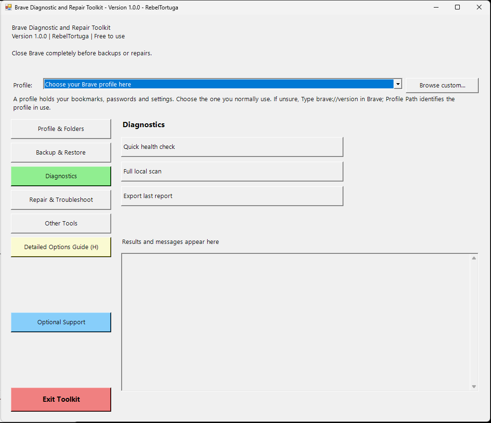

# Brave Diagnostic and Repair Toolkit
**Developer:** RebelTortuga  
**Platform:** Windows 10 / Windows 11  
**Version:** 1.0.0  
**Cost:** Free to use. No payment is required.

A Brave companion to the WoW Diagnostic and Repair Toolkit and Firefox Diagnostic and Repair Toolkit, with section navigation, diagnostics, category-selectable backup and restore, recovery copies, saved logs and detailed help. Independent utility; not affiliated with Brave Software.

## Screenshot

## Start here
1. Extract **all files** into a new folder.
2. Double-click **Brave Diagnostic and Repair Toolkit.bat**.
3. Choose the profile you normally use from the **Profile** dropdown at the top. It displays the profile name, folder and path. If unsure, type `brave://version` in Brave and compare **Profile Path** with the listed paths. Close Brave after checking.
4. Click **Diagnostics → Quick health check** and read the results.
5. Click **Backup & Restore → Save a backup - choose categories** before making changes.

The launcher uses Windows Script Host to open the graphical toolkit with PowerShell hidden. Keep the BAT, VBS and both PS1 files together. Windows PowerShell 5.1 is included with Windows 10 and 11; no PowerShell 7, Git, Python or administrator access is required. The execution-policy bypass applies only to the launched process. See [RUN-README.md](RUN-README.md) for download blocking guidance.

## Menu
| Section | Option | Action |
| --- | --- | --- |
| Profile & Folders | 1 | Choose profile using the dropdown at the top |
| Profile & Folders | 2 | Open selected profile folder |
| Profile & Folders | 3 | Open saved logs |
| Backup & Restore | 4 | Save selected backup categories |
| Backup & Restore | 5 | Verify and restore included categories |
| Diagnostics | 6 | Quick health check, full local scan and report export |
| Repair & Troubleshoot | 7 | Launch with extensions disabled |
| Repair & Troubleshoot | 8 | Move browser cache to a recovery folder |
| Repair & Troubleshoot | 9 | Open guided Brave settings reset |
| Repair & Troubleshoot | 10 | Instructions for creating a clean test profile |
| Other Tools | 11 | Open brave://version |
| Other Tools | 12 | Verify a toolkit backup |
| Other Tools | 13 | Feedback and GitHub information |
| Other Tools | 14 | Open official Brave help |
| Detailed Options Guide | H | Yellow guide button below Other Tools |
| Optional Support | 15 | Blue optional Ko-fi support button; asks before opening |
| Exit Toolkit | Exit | Red button below Optional Support |

Button order: Profile & Folders, Backup & Restore, Diagnostics, Repair & Troubleshoot, Other Tools, Detailed Options Guide, Optional Support, Exit Toolkit. Click a section on the left to display its actions. Diagnostics is green. The results caption is above the results box. Detailed Options Guide is yellow and directly below Other Tools. Optional Support is blue and has equal spacer rows between the yellow guide and red Exit Toolkit button. The numbered guide identifies actions; no typing of menu numbers is required.

## Backup choices
**Bookmarks:** Bookmarks and Bookmarks.bak when present. **Passwords:** Login Data and Login Data For Account databases and available journal files, plus the parent User Data folder's Local State. **Extensions:** user-installed extension files and supported dedicated storage, plus Preferences and Secure Preferences. **Settings:** Preferences and Secure Preferences. All selects these four categories for the chosen profile; it does not copy the entire profile or every profile.

History, website cookies, website storage, cache, session/open-tab files, autofill databases and downloaded files are excluded. Settings can contain tab-related configuration, but this backup does not provide complete open-tab or pinned-tab recovery. Record important tabs separately before a settings reset. Brave Wallet and Rewards recovery are not provided; keep their independent recovery information securely.

The extension selection logic retains the uploaded Brave backup's approach: internal/user-installed and unpacked entries, excluding default-installed and OEM-installed entries. Disabled user-installed entries are included; policy, external and component entries are excluded. Dedicated Local Extension Settings, Sync Extension Settings, Managed Extension Settings, Extension Rules, Extension Scripts, matching IndexedDB and Storage/ext folders are included when present. Shared Extension State is omitted. Some extensions need their own export; extension storage can contain sensitive data.

## Passwords and privacy
Backups are not encrypted by this toolkit. Password databases remain subject to Brave and Windows encryption; copying them is not a portable password export. Recovery is intended for the same Windows installation, user account and compatible Brave installation, and is not guaranteed after reinstalling Windows or moving computers. The toolkit does not decrypt or print passwords. Protect backups and recovery folders and never upload them as bug-report attachments.

## Restore behavior
Restore verifies SHA-256 hashes, stages a copy of the current User Data folder, overlays the backup onto the selected profile, then preserves the original User Data folder before swapping in the staged folder. If the final swap fails, it attempts to put the original back. Additional extensions may remain because the restore overlays files. Bookmarks and preferences are replaced, not merged. Password restores also replace shared Local State, which can affect other profiles and browser-wide settings; back up each profile first. Restore uses included categories without a second category picker.

This release creates and restores **BraveToolkit2** backups. Your earlier **BraveBackupEssentials1** backups remain separate and are not restored by this release. Keep the earlier backup utility and backups if you need them. SHA-256 checks detect file changes; they do not authenticate an untrusted backup. Use only your own trusted backups.

## Diagnostics and repair limits
PASS / WARN / FAIL / INFO / UNKNOWN describe local findings. Scans check file presence, size, running processes, disk space and, for the full scan, selected JSON parsing. They do not test SQLite integrity, password usability, extension compatibility or malware. Report exports are optional and saved where you choose; inspect personal paths before sharing.

Cache recovery moves only Cache, Code Cache and GPUCache from the selected profile. It does not move bookmarks, passwords or session files. Brave recreates cache as needed. Settings reset is guided: the toolkit opens Brave's settings, and you initiate and confirm the reset inside Brave. **Reset changes pinned tabs, startup settings, extensions/themes, content permissions and cookies/site data.** Bookmarks, history and saved passwords are retained according to Brave's official guidance. Read the confirmation inside Brave before proceeding.

## Settings and logs
Remembered profile: `%LOCALAPPDATA%\RebelTortuga\Brave-Toolkit\settings.json`. Session logs: `%LOCALAPPDATA%\RebelTortuga\Brave-Toolkit\Logs`. Cache recovery: `%LOCALAPPDATA%\RebelTortuga\Brave-Toolkit\Recovery`. Restore recovery folders and copy logs are beside the live User Data folder. Keep recovery data until you have checked Brave. Logs can contain personal file paths; review before sharing.

## Feedback
Use the repository's Issues tab for bugs, cleanup suggestions, additional options and feature requests. Include Windows and Brave versions, the action selected, reproduction steps and exact error text. Never attach passwords, profiles or backups. Author profile: https://github.com/RebelTortuga. A specific repository URL has not been supplied, so this release embeds no guessed repository address.

## Brave references
- Desktop help: https://support.brave.com/hc/en-us/categories/360001053032-Desktop-Browser
- Settings reset and its effects: https://support.brave.com/hc/en-us/articles/360017903152-How-do-I-reset-Brave-settings-to-default
- Browser version and selected profile path: `brave://version`
- Settings reset: `brave://settings/reset`

## 🐢 Support RebelTortuga

All features are free. A donation is never required and does not unlock anything.

**[☕ Help this turtle get a new shell on Ko-fi!](https://ko-fi.com/rebeltortuga)**

The in-app **Optional Support** button asks before opening the same page in your browser. The toolkit does not collect payment information.

## License

MIT; see [LICENSE](LICENSE).
